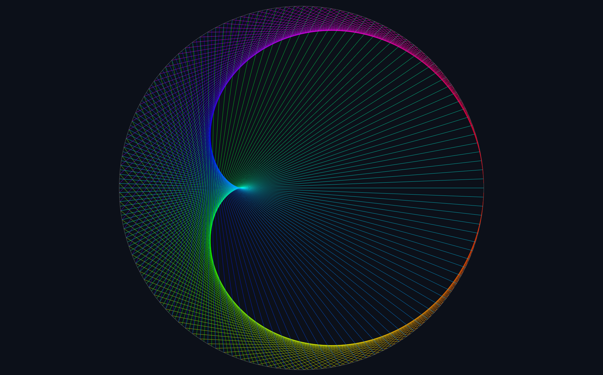

# Cardioid Visualizer

An interactive mathematical visualization application written in **Rust**, using **egui** and **eframe**.

The application explores geometric patterns generated by multiplication tables on a circle, with real-time animation, color gradients, and adjustable visual effects.



## Features

- Interactive visualization of modular multiplication patterns
- Adjustable multiplication factor and number of points
- Real-time animation with playback controls
- Rainbow color gradients
- Configurable temporal trail effect
- Fullscreen mode and collapsible control panel

## Mathematical background

The application distributes \(N\) points evenly around a circle.

Each point \(i\) is connected to another point determined by:

\[
j = (k \cdot i) \bmod N
\]

where:

- \(N\) is the number of points on the circle.
- \(i\) is the index of the starting point.
- \(k\) is the multiplication factor.

The coordinates are computed using:

\[
x_i = c_x + R\cos\left(\frac{2\pi i}{N}\right)
\]

\[
y_i = c_y + R\sin\left(\frac{2\pi i}{N}\right)
\]

For \(k=2\), the resulting lines form the envelope of a cardioid.

## Getting started

### Requirements

- Rust and Cargo
- A supported graphical environment

### Build and run

Clone the repository:

```bash
git clone https://github.com/YOUR_USERNAME/cardioid-visualizer.git
cd cardioid-visualizer
```

Run the application:

```bash
cargo run --release
```

## Controls

| Control      | Action                            |
| ------------ | --------------------------------- |
| F11          | Toggle fullscreen                 |
| Tab          | Show or hide the control panel    |
| Escape       | Exit fullscreen                   |
| Play / Pause | Start or stop the animation       |
| Reset        | Restore the initial visualization |

Additional parameters can be adjusted using the control panel.

## Technologies

- Rust
- egui / eframe

## License

This project is licensed under the MIT License.
See the [LICENSE](LICENSE) file for details.
